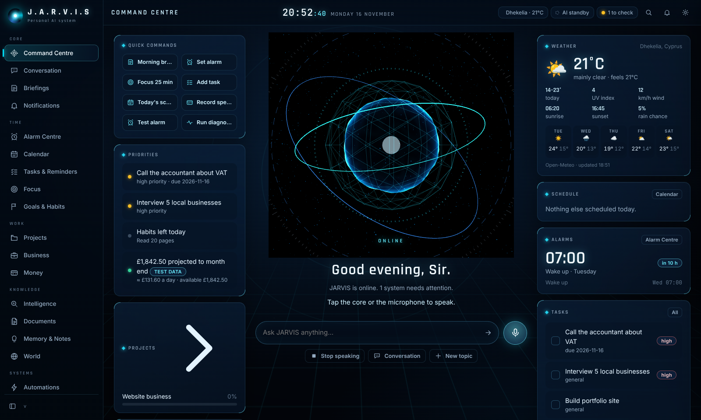

# JARVIS 3.0

JARVIS is your personal AI assistant. It runs on a small cloud server and is used from two places:
- **Windows app on your laptop.** It listens for **"Hey JARVIS"**, speaks back with a British voice and sits in the system tray.
- **iPhone home-screen app.** It shares the same account: conversations, tasks, reminders, projects, money and memory.



```
iPhone (home-screen app) ─┐                       ┌─ Claude (reasoning, web research)
                          ├─ HTTPS + WebSocket ─ JARVIS backend ─┼─ Monzo (read-only)
Windows app ──────────────┘    (one account,     │   (Render)    ├─ Google Calendar
  └ local “Hey JARVIS” wake word  live sync)     │               ├─ Open-Meteo weather
  └ allowlisted laptop actions                   └─ SQLite + daily backups, ElevenLabs/Whisper voice
```

---

## 1. Put the backend online (about 10 minutes, no terminal)

1. Click **[Deploy to Render](https://render.com/deploy?repo=https://github.com/9y6mfb88zk-eng/Dylan-Walsh)** and sign in with GitHub.
   - Render needs permission to read this repository.
   - It uses the **Starter** plan (about $7/month), which includes the persistent disk that stores your data.
2. When asked for the secret values, paste your keys (see **§5 Credentials**). Only `ANTHROPIC_API_KEY` is essential to start. You can add the rest later under **Environment**.
3. Wait for the first deploy to finish, then open the address Render gives you, e.g. `https://jarvis-xxxx.onrender.com`.
4. **First-time setup:**
   - In Render, open **Environment** and copy the value of `JARVIS_SETUP_TOKEN`.
   - Enter it on the JARVIS page and choose a password of 10 or more characters.
   - That browser becomes your first signed-in device.

Prefer Railway, Fly.io or your own server? The included `Dockerfile` works anywhere. Mount a volume at `/data` and set the variables from `.env.example`.

## 2. Install the Windows app

1. Open **[Releases → "JARVIS for Windows (latest)"](https://github.com/9y6mfb88zk-eng/Dylan-Walsh/releases/tag/desktop-latest)** and download `JARVIS-Setup-3.0.0.exe`.
   - GitHub Actions builds it automatically on every push.
   - The installer isn't code-signed, so SmartScreen may warn you. Choose **More info → Run anyway**.
2. Run the installer. On first launch, enter your server address (`https://jarvis-xxxx.onrender.com`) and sign in.
3. Allow the microphone when asked. If Windows blocks it, go to **Settings → Privacy & security → Microphone** and turn on "Let desktop apps access your microphone".
4. Say **"Hey JARVIS"**.

What the Windows app gives you:
- **Tray app.** Closing the window keeps JARVIS running. Choose **Exit JARVIS** in the tray menu (or Settings) to quit completely.
- **Start with Windows.** On by default; change it in the tray menu or in Settings → Voice & laptop. It starts hidden in the tray and begins listening.
- **Push-to-talk:** `Ctrl+Shift+Space` from any app.
- **Mute microphone:** `Ctrl+Shift+M`. You can also use the mic chip in the top bar or the tray menu.
- **Sleep and resume.** While the laptop sleeps the wake word is genuinely unavailable, and the health panel says so. It restarts on resume.

Developers can run from source instead:
```powershell
powershell -ExecutionPolicy Bypass -File scripts\windows\setup.ps1      # installs Node if needed, deps, creates .env
powershell -ExecutionPolicy Bypass -File scripts\windows\start-dev.ps1  # backend on localhost:3000 + the Windows app
```

## 3. Add JARVIS to your iPhone

1. On the laptop, go to **Settings → Devices & pairing → Show pairing code**.
2. Point the iPhone **Camera** at the QR code and open the link in Safari. The phone is signed in to the same account.
3. In Safari, tap **Share → Add to Home Screen**. Open JARVIS from the new icon.
4. Go to **Settings → Notifications → Turn on**. Reminders, briefings and research results will now arrive even when every app is closed.

iOS doesn't let web apps listen in the background, so the phone has no wake word. Tap the core or the mic to talk (this uses Whisper, so `OPENAI_API_KEY` is needed). The laptop is the always-listening device.

## 4. Connect Monzo (read-only)

1. Sign in at **developers.monzo.com** with your Monzo account and approve the login in the Monzo app.
2. Go to **Clients → New OAuth Client** and set:
   - **Name:** JARVIS
   - **Logo URL:** leave blank
   - **Redirect URLs:** `https://YOUR-SERVER/oauth/monzo/callback`
   - **Confidentiality:** Confidential
3. Copy the **Client ID** and **Client secret** into Render as `MONZO_CLIENT_ID` and `MONZO_CLIENT_SECRET`. Save; Render redeploys.
4. In JARVIS, go to **Money → Connect Monzo**. Sign in on Monzo's own page. JARVIS never sees your password, PIN or card.
5. **Approve "JARVIS" in the Monzo app.** Monzo requires this extra step. Until then the status reads *Waiting for approval*. Then tap **Sync now**.
6. Under **Money → Bank connection**, choose which accounts JARVIS may use. **Disconnect** revokes access and deletes the stored data.

About the Monzo developer API:
- It is meant for **personal use with your own account**, which is exactly this use case. Monzo can change or limit it.
- Monzo only returns the last 90 days of transactions after the first 5 minutes of a connection.

If it doesn't suit you, the calculations accept any provider. TrueLayer's Data API is the documented alternative, but it needs its own approval for live access. It isn't built yet; see **Limitations**.

For an accurate "money left", add your bills, planned savings and debt repayments under **Money → Still to pay**.
- Mark each one **confirmed** or **estimated**. JARVIS labels estimates as estimates.
- Fill in "text in the bank description" so a bill is ticked off once it is paid.

## 5. Credentials

| Variable | Needed for | Where to get it |
|---|---|---|
| `ANTHROPIC_API_KEY` | **Required.** Conversation, tools, web research, briefings, ideas | console.anthropic.com → API Keys |
| `JARVIS_SETUP_TOKEN` | Claiming your fresh install (one time) | Render generates it; otherwise any long random string |
| `JARVIS_ENCRYPTION_KEY` | Encrypting bank and calendar tokens at rest | Render generates it. Never change it after connecting accounts |
| `OPENAI_API_KEY` | **Voice input in the Windows app and on iPhone** (Whisper), backup voice, semantic memory search | platform.openai.com → API keys |
| `ELEVENLABS_API_KEY` | Natural British butler voice (recommended) | elevenlabs.io → Profile → API keys |
| `MONZO_CLIENT_ID` / `MONZO_CLIENT_SECRET` | Monzo | developers.monzo.com (see §4) |
| `GOOGLE_CLIENT_ID` / `GOOGLE_CLIENT_SECRET` | Google Calendar (optional) | See below |

You don't need keys for:
- **Weather** (Open-Meteo).
- **Push notifications.** The keys are generated automatically.
- **The wake word.** The free openWakeWord `hey_jarvis` model ships inside the app.

**Google Calendar:**
1. In console.cloud.google.com, create a project and enable the **Google Calendar API**.
2. Go to **APIs & Services → OAuth consent screen**: choose External and add yourself as a test user.
3. Go to **Credentials → Create OAuth client ID** and choose Web application. Set the authorised redirect URI to `https://YOUR-SERVER/oauth/google/callback`.
4. Put the ID and secret into Render.
5. In JARVIS, go to **Agenda → Connect Google Calendar**.

Without Google, JARVIS's own calendar still works.

## 6. Configure the wake word

All of this is on the laptop under **Settings → Voice & laptop**:
- **Listen for "Hey JARVIS"** (on/off) and **Mute microphone**.
- **Microphone:** pick a device. If it's unplugged, the service retries automatically and recovers.
- **Detection threshold** (default 0.5): raise it if JARVIS wakes by mistake, lower it if he misses you.
- **Consecutive frames** (default 2, about 160 ms above the threshold): this is the false-trigger protection, together with a 2.5-second cooldown.
- **Speech sensitivity:** how loud you must be once a command has started.
- **Live score meter:** say "Hey JARVIS" and watch it peak.

**Privacy:** detection runs on the laptop.
- Uses the openWakeWord `hey_jarvis_v0.1` ONNX model, executed in the app via onnxruntime-web.
- Idle audio never leaves the computer. After the wake phrase, only your command is recorded and sent for transcription.
- While a conversation is running, the wake word pauses so JARVIS can't wake himself.

## 7. What JARVIS can do

| Ask | What happens |
|---|---|
| "Good morning, JARVIS" / "Brief me" | Briefing from real data: weather, calendar, tasks, reminders, money, projects (news optional). Also pushed daily at your chosen time |
| "How much money have I got?" | Live Monzo balance, minus remaining commitments, with the working shown. Credit/overdraft limits never count |
| "How much have I spent this month / on food?", "Can I afford £300?", "Show my subscriptions", "Compare with last month" | Finance engine over your real transactions. Transfers between your own accounts are excluded |
| "What's the weather tomorrow?" | Open-Meteo forecast for your home location |
| "Remind me to call my mum at six" | Server-side reminder. Arrives on your phone even with every app closed; the laptop also speaks it |
| "Schedule a gym session tomorrow", "Move my dentist to Friday" | Creates events. Clashes and changes to existing events wait for your **yes** |
| "I want to start a business" | Creates a project with milestones and first tasks; "continue working on my website business" picks it up |
| "Research the best businesses to start in Larnaca" | Web search across several sources, with citations; longer reports run in the background |
| "Open Chrome", "Open my downloads", "Open my JARVIS project", "Create a document", "Find my latest CV" | Allowlisted laptop actions. Name your own shortcuts in Settings |
| "Remember that I prefer tea" | Saved to memory. Sensitive facts wait for approval; passwords, PINs and card numbers are refused |

## 8. Security

- **Sign-in and devices.**
  - One owner account (scrypt-hashed password) with a one-time setup code.
  - Every device has its own session and can be signed out from **Settings → Devices**.
  - Session tokens are random 256-bit values stored only as hashes. They rotate daily and expire after 30 idle days (180 days maximum).
- **Request protection.** CSRF protection, rate limits (login lock-out after 8 failures in 15 minutes), a strict CSP and security headers, and an **audit log** of sign-ins, pairings, finance and calendar changes, laptop actions and memory exports.
- **Bank and calendar access.**
  - Tokens are encrypted with AES-256-GCM, stay on the server and are never sent to devices. Bank passwords are never seen or stored.
  - OAuth uses single-use, expiring state values. Finance access is read-only.
- **Laptop actions.**
  - Only a fixed allowlist of actions is possible, validated on the server and again on the laptop.
  - There is no shell, no delete, no install, no settings changes and no running programs.
  - Actions are logged to `%APPDATA%\JARVIS\actions.log` and to the audit log.
- **Desktop app hardening.**
  - Context isolation and sandboxing are on. The desktop bridge exists only for pages from your JARVIS server.
  - Microphone permission is granted only to JARVIS's own windows, and Windows privacy settings are respected, never bypassed.
- **Backups.** A daily SQLite backup goes to `/data/backups` and the last 7 are kept.

## 9. Tests and results

```bash
npm ci && npm test                  # 32 tests: backend end-to-end against stand-in services, plus the finance engine
cd desktop && npm ci && npm test    # 12 tests: real hey_jarvis model accuracy and false triggers, laptop action allowlist
npm run test:ui                     # 14 checks: real UI in Chromium at laptop and iPhone size
npm run test:electron               # 20 checks: the real Windows app under Electron, with "Hey JARVIS" fed in as microphone audio
```

Latest run: **all 78 checks pass.** CI runs the unit tests on Linux and Windows, then builds the installer.

Your 8 acceptance scenarios:

| Scenario | Status |
|---|---|
| 1. Restart Windows → JARVIS starts in the tray and shows real status | Start-with-Windows (`--hidden`), tray status and the backend health panel are built. The full app was tested under Electron on Linux; **not run on a real Windows reboot** |
| 2. "Hey JARVIS" starts a voice session | **Passed end to end in Electron**: a recording of the phrase fed in as the microphone was detected locally, then the command was transcribed, answered, spoken and synced. **Not yet tried with your microphone and voice** |
| 3. "What's the weather tomorrow?" | Passes against Open-Meteo's real response format. **Live Open-Meteo calls were blocked by this build environment's network**, so the first live call happens on your server |
| 4. "How much money have I got?" | Full OAuth, pending in-app approval, sync and answer tested against a Monzo API stand-in. **Needs your Monzo client to run live** |
| 5. "How much have I spent this month?" | Same as 4. Transfers to pots and declined payments are correctly excluded |
| 6. "Remind me to call my mum at six" | Passes: persistent, delivered by web push and live to the laptop, and survives a server restart |
| 7. Open JARVIS on iPhone and see the same account | Passes in the iPhone-sized browser test: QR pairing, shared conversation, shared tasks and reminders |
| 8. Disconnect and reconnect the internet | Passes: offline actions queue on the device and sync exactly once on reconnect. The app shows a reconnecting screen and retries with back-off |

## 10. Limitations (honest list)

- **Not yet tested with your real accounts, voice or microphone.** All external services were exercised against faithful stand-ins. No live Anthropic, Monzo, Google, ElevenLabs or OpenAI calls were made during development, because no keys were available.
- **The Windows installer is built by GitHub Actions.** It wasn't built locally (no Windows machine here). If the first CI run fails, the log in the Actions tab says why.
- **Monzo developer API** access is Monzo's decision. It covers your own account; Monzo doesn't expose standing orders or direct debits, so upcoming bills come from what you enter plus detected repeating payments (labelled as estimates). **TrueLayer isn't implemented yet.**
- **The iPhone can't listen for a wake word in the background** (an iOS rule). Push notifications on iPhone need iOS 16.4+ and the home-screen app.
- **Voice input in the Windows app needs `OPENAI_API_KEY`.** Electron has no built-in speech recognition, so Whisper is used.
- **Laptop actions run only while the Windows app is running and online.** Anything destructive (deleting, installing, purchases, emails, settings, payments) is deliberately not possible.
- **Single-user design.** One owner account, one server instance (SQLite). That's right for a personal assistant, not for a shared service.

## Project layout

```
server/                 Backend (Node 22, Express, SQLite via node:sqlite, WebSocket)
  migrations/           Numbered SQL migrations, applied automatically at start-up
  security/             Auth, sessions, pairing, crypto, rate limits, audit
  finance/              Monzo sync service, categorisation, calculation engine
  integrations/         Monzo, Google Calendar, Open-Meteo clients
  services/             Tasks/projects, conversations, memory, calendar, confirmations, health, laptop actions
  brain.js              JARVIS persona, tools, research, briefing, ideas (Claude)
public/                 iPhone/desktop web app (PWA): views, holographic core, voice, live sync
desktop/                Windows app (Electron): tray, wake-word audio service, actions, installer config
  models/               openWakeWord ONNX models (melspectrogram, embedding, hey_jarvis_v0.1)
test/, desktop/test/    Automated tests
render.yaml, Dockerfile One-click cloud deployment
scripts/windows/        Windows setup and development start scripts
```
