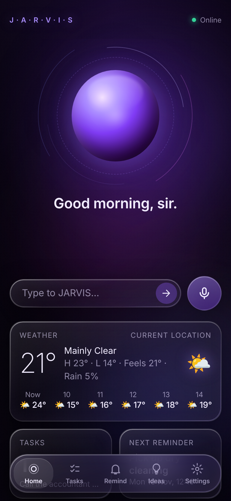

# JARVIS

JARVIS is a voice-first personal assistant: a dry, composed British butler who calls you "sir". It is an installable PWA with a dark violet Liquid Glass interface. You get an orb that reacts to real audio, spoken replies with a soft caption, tasks, server-side reminders, a morning briefing with real weather, and a background engine that comes up with startup ideas.



## Quick start

```bash
git clone https://github.com/9y6mfb88zk-eng/Dylan-Walsh.git jarvis && cd jarvis
git checkout claude/jarvis-prototype-spec-lpz2sl
npm install
cp .env.example .env        # then paste your keys into .env
npm start                   # http://localhost:3000
```

You need Node 22.13 or newer. There are no native dependencies: it uses the built-in `node:sqlite`.

```bash
npm test                    # 11 end-to-end API tests against mocked upstreams
node test/ui-check.js       # drives the real UI in Chromium, saves docs/screenshots/
npm run dev                 # auto-restart on file changes
npm run vapid               # print a VAPID key pair to pin in .env (optional)
```

## Credentials

| Variable | Needed for | Where to get it |
|---|---|---|
| `ANTHROPIC_API_KEY` | **Required.** Conversation, tools, briefing, idea engine | console.anthropic.com → API Keys |
| `ELEVENLABS_API_KEY` | Neural British butler voice (recommended) | elevenlabs.io → Profile → API Keys |
| `OPENAI_API_KEY` | Whisper transcription (**needed for voice input on iPhone**), plus backup TTS | platform.openai.com → API keys |
| `JARVIS_PASSCODE` | Protects the app once it is on the internet | Choose any passphrase |

You do **not** need keys for:
- Weather (Open-Meteo is free).
- Push notifications. VAPID keys are generated on first run and stored in `data/`.

If no TTS key is set, JARVIS falls back to the browser's British voice ("Daniel" on iPhone). If no OpenAI key is set, voice input uses Web Speech in Chrome and Safari on desktop, and you type on iPhone.

## Using it on your iPhone

Push notifications and the microphone need **HTTPS**, so JARVIS has to be reachable at an https URL.

**Option A: a quick tunnel from your computer.**
```bash
npm start
npx cloudflared tunnel --url http://localhost:3000   # prints https://<random>.trycloudflare.com
```

**Option B: always on.** Recommended, so reminders fire while your laptop sleeps. Deploy the included `Dockerfile` to Railway, Render or Fly.io:
- Add the env vars above.
- Mount a persistent volume at `/data`.

Then, on the iPhone:
1. Open the https URL in **Safari** and enter your passcode.
2. Tap **Share → Add to Home Screen**, then open JARVIS from the home-screen icon.
3. Go to **Settings → Notifications → Enable** and allow. Also allow Location.
4. Tap the orb or mic and talk.

## What's in it

- **Conversation.**
  - There is no chat log. JARVIS speaks its reply and shows a one-line caption under the orb.
  - The model is Claude Opus 5.5 at low effort, so replies come back fast.
  - It has tools for tasks, reminders, weather, long-term memory and reading your ideas.
  - Server-side refusal fallback is enabled (`fallbacks: "default"`).
- **Orb.**
  - Speaking: ripple rings, a brighter core and a bar waveform, all driven by an `AnalyserNode` on the real TTS audio.
  - Listening and thinking: calmer versions. Listening follows the live mic level when recording for Whisper.
- **Voice.**
  - Output: ElevenLabs (`George`, `eleven_flash_v2_5`) or OpenAI `gpt-4o-mini-tts` (`fable`, with butler instructions). The server streams the audio.
  - The client fetches the first sentence on its own so speech starts sooner.
  - Tapping the orb while JARVIS is speaking interrupts it and starts listening.
  - Input: Web Speech where it is reliable; otherwise it records with MediaRecorder, detects silence and sends the audio to Whisper (`/api/transcribe`).
- **Location and weather.** JARVIS asks for geolocation once and defaults to Dhekelia, Cyprus (Europe/Nicosia). The server fetches Open-Meteo and caches it for 10 minutes. The weather card shows hourly temperatures, and the briefing uses the same data.
- **Briefing.**
  - Tap **Brief me**, or get a push every day at `BRIEFING_TIME` (07:30 Nicosia).
  - Tapping the notification opens the app, and one tap on the orb plays the briefing. iOS requires that tap before audio can play.
- **Ideas.**
  - Every 30 minutes, the server asks Claude (structured output) for the best new AI or SaaS idea for a solo founder in Cyprus on a small budget: a pitch, a 3-step MVP and a first move this week.
  - All earlier titles go into the prompt, and a similarity check stops repeats.
  - Each idea is saved to SQLite and sent as a push. The Ideas tab has **Add first move to tasks**.
- **Reminders.** Set them by voice ("remind me in 20 minutes to…") or in the Reminders tab. A server loop checks every 20 seconds and sends a web push, so reminders fire even with the app closed.
- **PWA.** It has a manifest, icons (including apple-touch and maskable), and a service worker that keeps the app shell available offline and handles push.

## Layout

```
server/
  index.js      Express API + static PWA + passcode cookie
  brain.js      Claude: persona, tool loop, briefing, idea generator
  scheduler.js  reminders / ideas / daily briefing jobs
  voice.js      ElevenLabs/OpenAI TTS streaming, Whisper transcription
  weather.js    Open-Meteo
  push.js       web-push (VAPID)
  db.js         SQLite (node:sqlite) in data/jarvis.db
public/         index.html, styles.css, app.js, sw.js, manifest, icons
test/           e2e tests, mock upstreams, UI screenshot check
```
